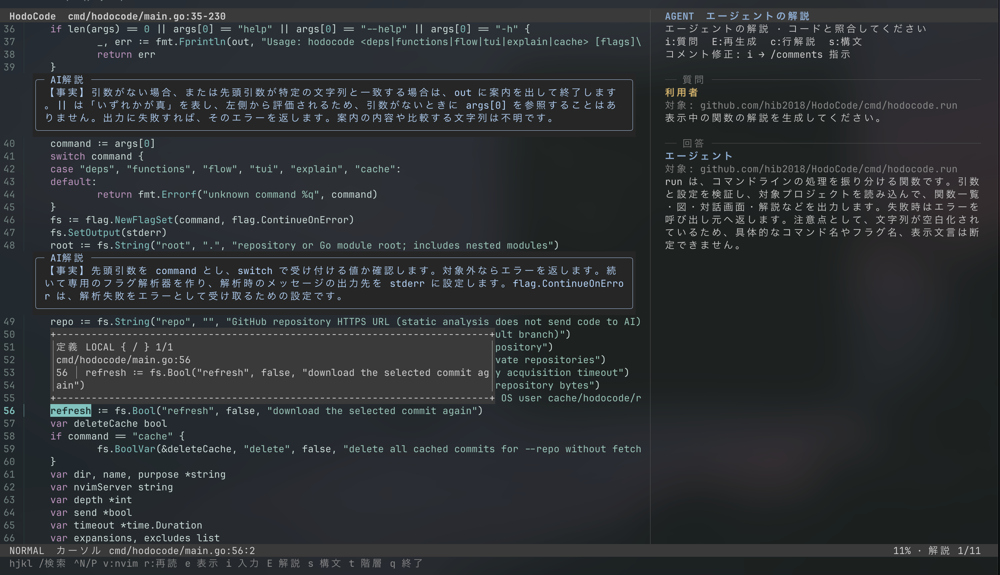

# HodoCode

Go・Zig・TypeScript・Rust・C・JavaScript・Pythonコードを読むためのCLI／TUIです。
依存関係図、呼び出し図、構文解説を表示します。
ローカルとGitHubのリポジトリに対応します。



## はじめる

Go 1.23以上が必要です。外部Go依存はありません。

```sh
go build -o hodocode ./cmd/hodocode
./hodocode tui --root /path/to/repo
```

`--root` に解析するリポジトリを指定します。
言語は自動検出します。`--language go|zig|ts|rust|c|js|python` で絞り込めます。
Go以外は `go.mod` 不要です。複数のGoモジュールにも対応します。
起点の `main` が一意でなければ、`--func` で関数を選びます。

## できること

| コマンド | 用途 |
| --- | --- |
| `tui` | コード、構文解説、呼び出しツリーを表示 |
| `functions` | 関数とソース位置を一覧表示 |
| `deps` | import依存をMermaidで出力 |
| `flow` | 関数の呼び出し関係をMermaidで出力 |
| `explain` | AIへ送る候補を確認。`--send` で解説を生成 |
| `cache` | 取得済みリポジトリのキャッシュを削除 |

```sh
./hodocode functions --root /path/to/repo
./hodocode flow --root /path/to/repo --func main
./hodocode deps --root /path/to/repo
./hodocode tui --repo https://github.com/owner/repo --ref main
```

全画面TUIはmacOS／Linuxで利用できます。
`h/j/k/l` で移動し、`Enter` で呼び出し先へ進みます。
`b` で戻り、`t` でツリーを開きます。
`v` でNeovimを開き、`r` で再解析します。`q` で終了します。

## 多言語対応の範囲

| 言語 | 対象 |
| --- | --- |
| Zig | `.zig` の関数、`@import`、直接呼び出し |
| TypeScript | `.ts` の関数、アロー関数、クラスメソッド、import/export |
| Rust | `.rs` の関数、implメソッド、mod/use |
| C | `.c`・`.h` の関数定義、`#include` |
| JavaScript | `.js`・`.mjs`・`.cjs` の関数、アロー関数、メソッド、ES Modules/CommonJS |
| Python | `.py` の関数、async関数、クラスメソッド、import/from import |

追加言語は保守的な字句・構造解析です。型検査・ビルド・対象コードの実行は行いません。
確定できない参照は未解決として表示し、言語間の呼び出しは解決しません。
詳細な限界は[対応範囲](docs/languages.md)を参照してください。

## AI解説と送信

静的解析と構文解説はAIへコードを送りません。
ローカル解析にネット接続は不要です。
GitHubからの取得には通信が必要です。

AI解説には、インストール・認証済みの `fx` が必要です。
CLIは `explain --send` で送信します。
TUIは `E`、または `e` → `i` → 指示入力 → `Enter` で送信します。
TUIの送信前に確認ダイアログは出ません。
行単位の質問は `a` で入力、`?` で定型質問を下書きし、`C` の一覧で編集・選択して `Enter` でまとめて送信できます。下書き保存だけでは送信しません。

送信前に、[日本語ガイド](docs/ja/guide.md)の注意事項を確認してください。
除外・文字列の空白化だけでは、機密情報を完全には除去できません。
画像内のAI解説も、正確さを保証するものではありません。

## ドキュメント / Documentation

| | 日本語（JP） | English（EN） |
| --- | --- | --- |
| 使い方 / User guide | [ガイド](docs/ja/guide.md) | [Guide](docs/en/guide.md) |
| 構文解説 / Syntax help | [カタログ](docs/ja/syntax-help.md) | [Catalog](docs/en/syntax-help.md) |

## 開発

```sh
go test ./cmd/hodocode ./internal/analyze ./internal/explain
```
